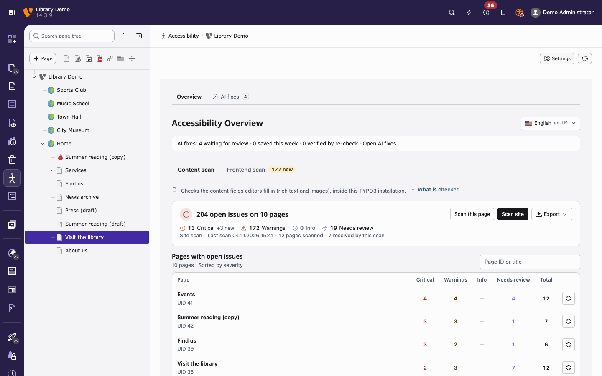
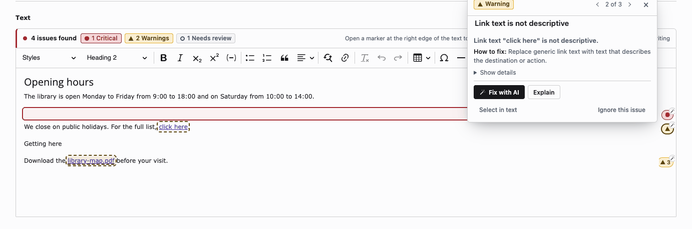
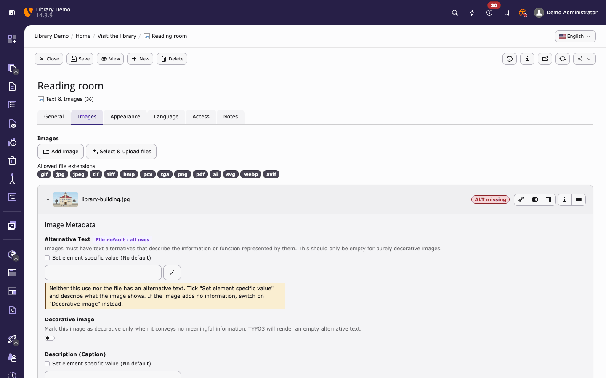
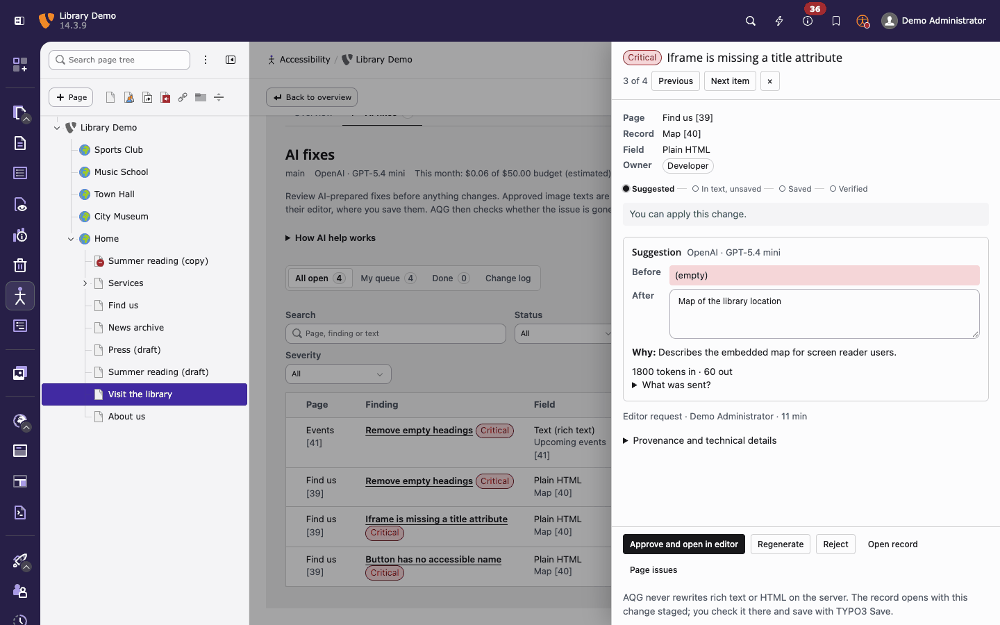
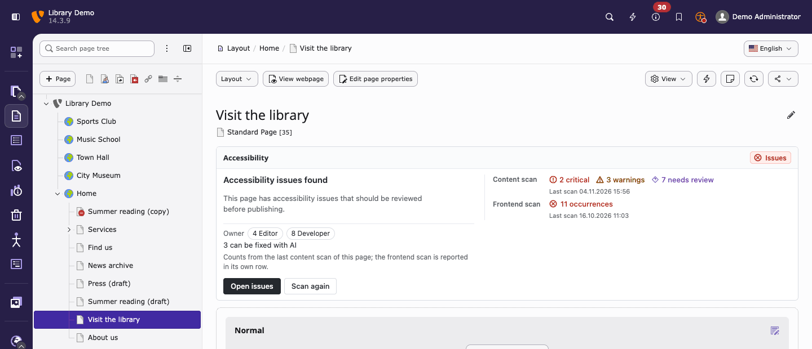

# Accessibility Quality Gate for TYPO3

[](https://packagist.org/packages/priebera/typo3-a11y-quality-gate)
[](https://packagist.org/packages/priebera/typo3-a11y-quality-gate)


Accessibility Quality Gate (AQG) brings accessibility quality assurance into the TYPO3 backend. Editors see
accessibility problems while they write, every finding stays attached to the TYPO3 page, record and field that
caused it, and a Quality Gate can warn or block publishing while too many problems are open. AQG 3.0 adds optional
AI help that prepares fixes for review — nothing changes until a person applies it and saves.

AQG automates the repeatable part of accessibility testing. It is not a certification service and does not
replace manual testing — see [Scope](#scope).

[Product](https://typo3.priebera.sk/products/accessibility-quality-gate) ·
[Documentation](https://typo3.priebera.sk/docs) ·
[Pricing](https://typo3.priebera.sk/pricing) ·
[Free Trial](https://typo3.priebera.sk/trial) ·
[Support](https://typo3.priebera.sk/contact) ·
[Packagist](https://packagist.org/packages/priebera/typo3-a11y-quality-gate) ·
[TER](https://extensions.typo3.org/extension/a11y_quality_gate)



## Why accessibility checks belong inside TYPO3

Generic accessibility scanners look at a finished URL. They report that something is wrong on a page, but not which
content element, which field or which editor can fix it. AQG works where the content is made:

- **At the source.** Rich text, image metadata, headers, links, embeds and forms are checked as TYPO3 records. A
  finding names the record and field, and **Edit record** opens it.
- **While editing.** CKEditor and Plain HTML content elements show problems as they appear, with a short
  **How to fix** for each rule.
- **Before publishing.** The Quality Gate runs when a page is unhidden or published, including workspace publishing.
- **On the delivered page as well.** A rendered page check inspects the HTML TYPO3 delivers, and a browser-based
  frontend scan on the AQG service runs axe-core on published pages, including JavaScript-rendered content.
- **Within TYPO3 permissions.** Results, scans and fixes follow page, record and field permissions. Module access alone
  opens no result.

## What editors experience

Open a text element and AQG marks problems directly in CKEditor or in the HTML code editor. The summary bar counts
the issues; a marker at the right edge opens the explanation and the fix. After **Save**, AQG checks the saved record
again and reports what is resolved.



For images in content elements, AQG shows the state of each image use — alternative text missing, own text,
inherited from the file, or decorative — and a short hint how to fix a missing text. This works without a licence and
without AI.



## Optional AI help that stays under review

With a PRO or Agency licence and an AI provider configured by an administrator, supported findings offer
**Fix with AI** and **Explain with AI**: link text, image alternative text, button names, iframe titles and empty
headings. Every suggestion shows Before and After, can be edited, and is applied only by a person; TYPO3 Save stores
it and AQG verifies the saved record. The **AI fixes** view collects prepared changes per site for review, approval
and a change log.



- **Bring your own key:** OpenAI or Anthropic Claude, one provider and one verified model per site. Requests go from
  your TYPO3 installation directly to the provider.
- **Off until an administrator sets it up:** licence, key, verified model, data processing acknowledgement and budget
  must all be in place before editors see AI. Without them, every non-AI feature works unchanged.
- **Cost control:** monthly budget per site with a warning e-mail and an optional hard stop, usage and estimated cost
  per feature, and User TSconfig switches per group.
- **Deterministic checks never use AI.** Scans, findings, How to fix, the Quality Gate and reports never call an AI
  provider. AI does not fix every issue, does not decide conformance and never saves on its own.

## Scans, governance and reporting

- **Content scan** of RTE fields and structured TCA values, per page or site, from the backend, CLI or Scheduler.
- **Rendered page check** of the server-rendered HTML (no JavaScript execution).
- **Frontend scan** in a real browser on the AQG service: the limited daily Free Remote Preview, or full page and site
  scans with a licence, with priority fixes, affected pages, screenshots, history and comparisons of compatible scans.
- **Page Detail** with severity groups, How to fix, ignore with reason and expiry, an owner per issue type and a page
  remediation plan.
- **Page module and toolbar** status for the current page and site. The toolbar opens with **Ask AQG** for the page,
  content element or file you are working on: common questions (what to fix first, why, where) are answered from your
  findings without AI and at no cost; with AI set up, other questions use the site's own provider key, budget and
  privacy settings, and answers never change content. Content scan and Frontend scan follow as collapsed sections, and
  the footer offers **Open Accessibility** and, where agent access is usable for you, **Open MCP**.
- **Results follow TYPO3 permissions:** findings, counts and exports show only what the user may read now (page,
  record, table, language, workspace). Frontend results without a readable page or record, and results stored before
  3.0, are administrators only; restricted views say so instead of reporting a clean scan.
- **Quality Gate** on publish and unhide: warning mode for everyone, blocking mode and per-site rules with a licence.
- **Exports:** CSV in every edition; PDF reports, acceptance evidence and scheduled monitoring with PRO or Agency. PDF
  export needs a Composer installation (see [Installation](#installation)).



## Agent access (MCP)

The extension contains a connector for AI agents (Model Context Protocol) with ten read and page-scan tools (frontend
findings, scan history, single-page scans and, with the separate `content:read` scope, local content findings),
consent per TYPO3 user with "My connected agents", and revocation. It is **off by default and not publicly available in 3.0.0**: it needs the hosted AQG MCP Gateway,
which AQG has not opened yet, and an administrator must grant `options.a11y_quality_gate.mcp.connect` per group and
turn sites on. Agents never change content; site crawls and AI changes by agents are not offered. See
[Agent access](Documentation/Developer/AgentAccess.rst).

## Free and paid features

| | Free | Trial | PRO | Agency |
|---|:-:|:-:|:-:|:-:|
| Live checks in CKEditor and Plain HTML, How to fix | ✓ | ✓ | ✓ | ✓ |
| Image ALT status and guidance, manual image fixes | ✓ | ✓ | ✓ | ✓ |
| Content scan, rendered page check, CLI and Scheduler | ✓ | ✓ | ✓ | ✓ |
| Overview, Page Detail, Page module, toolbar, ignore workflow | ✓ | ✓ | ✓ | ✓ |
| Quality Gate warning mode, CSV export of local findings | ✓ | ✓ | ✓ | ✓ |
| Free Remote Preview (limited daily browser scan) | ✓ | — | — | — |
| Frontend page and site scans, screenshots, history, comparisons | — | ✓ | ✓ | ✓ |
| Quality Gate blocking mode, per-site rules | — | ✓ | ✓ | ✓ |
| PDF export¹, acceptance evidence, Verify fix, scheduled monitoring | — | — | ✓ | ✓ |
| AI help (bring your own OpenAI or Anthropic key), AI fixes | — | — | ✓ | ✓ |
| Accessibility Statement Assistant | — | — | ✓ | ✓ |
| Several client installations on one licence, multi-site monitoring | — | — | — | ✓ |

¹ PDF export (reports, acceptance evidence as PDF, statement PDF) works only in Composer installations; the TER package
for Classic mode does not include the mPDF library. Every other feature, CSV export included, works in both.

The Trial column describes trial licence keys (`aqg_trial_…`). A trial issued as an Agency licence has every
Agency feature for its duration. Current trial terms, plan limits and prices are published on the
[trial](https://typo3.priebera.sk/trial) and [pricing](https://typo3.priebera.sk/pricing) pages; the documentation has
the [detailed feature table](Documentation/Introduction/Index.rst).

## Requirements

- TYPO3 13.4 LTS or TYPO3 14.3+
- PHP 8.2 or higher
- `ext-sodium` to store AI provider keys and remote-access passwords encrypted
- No additional service for the Free features; frontend scans and licence checks use the hosted AQG service

## Installation

```bash
composer require priebera/typo3-a11y-quality-gate
vendor/bin/typo3 extension:setup
vendor/bin/typo3 cache:flush
```

Classic mode (non-Composer) installations can install the extension from the
[TER](https://extensions.typo3.org/extension/a11y_quality_gate) and use every feature except PDF export: the TER
package does not include the `mpdf/mpdf` library, so the backend offers CSV and explains that PDF needs Composer.

Then, in the TYPO3 backend:

1. Open **Accessibility** (below **Web** in TYPO3 13, below **Content** in TYPO3 14).
2. Select a page of a TYPO3 site and choose **Scan site** to run the first content scan.
3. Review the discovered fields under **Settings › Scan fields** and the rules under **Settings › Rules**.
4. Optional: enter a licence key under **Settings › Licence**, set up AI under **Settings › AI suggestions** and the
   publishing rules under **Settings › Quality Gate**.
5. Give editor groups access to the Accessibility module and the TYPO3 rights they need — see
   [Permissions](Documentation/Configuration/Permissions.rst).

Upgrading from 2.x: run `extension:setup` for the new tables, then confirm the data processing acknowledgement and
test the AI connection once per site before editors get AI again. See [Upgrade](Documentation/Upgrade/Index.rst).

## Configuration at a glance

| Where | What |
|---|---|
| Accessibility › Settings | Licence, scan fields, rules, Quality Gate, remote scan access, AI, scan history, statement |
| User TSconfig `options.a11y_quality_gate.*` | Scan buttons, toolbar item, editing findings, image fixes, AI per group (`ai.editor`, `ai.images`, `ai.writing`, `ai.bulk`) |
| Site settings `a11yQualityGate.dictionary.*` | Language and phrases for the link-text rules |
| Extension configuration | Licence key, PRO upgrade offers in the Free Remote Preview |

```typo3_typoscript
options.a11y_quality_gate {
    showScanNow = 1
    showScanAll = 1
    ai.editor = 1
    ai.writing = 0
}
```

The options only narrow what TYPO3 allows; none of them grants a TYPO3 right.

## Command line

```bash
vendor/bin/typo3 a11y:scan --root-pid=1                 # content scan of a page tree
vendor/bin/typo3 a11y:scan --page-uid=42                # one page, including the rendered check
vendor/bin/typo3 a11y:scan --root-pid=1 --changed-only  # only changed content
vendor/bin/typo3 a11y:monitor --site=main --notify=web@example.org   # PRO / Agency
vendor/bin/typo3 a11y:history:prune                     # dry run; add --apply to delete
```

The Scheduler offers the content scan and *Accessibility monitoring (AQG PRO/Agency)* as tasks.

## Scope

AQG helps teams find and fix common accessibility problems early. It does not guarantee or certify conformance with
WCAG, the European Accessibility Act, BFSG, BITV or any other law or standard, and it does not replace keyboard
testing, assistive technology testing or an expert audit. Automated checks cover part of WCAG; findings need review in
context. AI suggestions can be wrong and are always reviewed by a person. AQG only knows the pages it has scanned.

## Documentation and help

| | |
|---|---|
| **Documentation** | https://typo3.priebera.sk/docs (source in [`Documentation/`](Documentation/Index.rst)) |
| **Rule reference** | https://typo3.priebera.sk/docs/rules-reference |
| **Changelog** | [CHANGELOG.md](CHANGELOG.md) |
| **Product** | https://typo3.priebera.sk/products/accessibility-quality-gate |
| **Support** | https://typo3.priebera.sk/contact · [SUPPORT.md](SUPPORT.md) · [SECURITY.md](SECURITY.md) |
| **Trial / Pricing** | https://typo3.priebera.sk/trial · https://typo3.priebera.sk/pricing |
| **Customer portal** | https://typo3.priebera.sk/portal |
| **Repository** | https://github.com/priebera1/typo3-a11y-quality-gate |
| **Packagist** | https://packagist.org/packages/priebera/typo3-a11y-quality-gate |
| **TER** | https://extensions.typo3.org/extension/a11y_quality_gate/ |

## Compatibility

| Version | TYPO3 | PHP | Support |
|---|---|---|---|
| 3.0 | 13.4 LTS / 14.3+ | 8.2+ | Features and bugfixes |
| 2.0 – 2.1 | 13.4 LTS / 14.3+ | 8.2+ | Superseded by 3.0 (same requirements; see the upgrade notes) |
| 1.4 – 1.9 | 13.4 LTS / 14.3+ | 8.2+ | Superseded by 2.0 (same requirements; see the upgrade notes) |
| 1.3.x | 13.4 LTS | 8.2+ | Security and bugfixes |

## License

GPL-2.0-or-later
